# 从点亮一个字到取模显示汉字：STM32F103C8T6 + 0.96 寸 I2C OLED 显示实验

> 平台：STM32F103C8T6 最小系统核心板（Blue Pill）+ 0.96 寸 128×64 I2C OLED（SSD1306）  
> 环境：STM32CubeMX 6.16.1（STM32Cube FW_F1 V1.8.7）+ Keil MDK-ARM V5.32 + ST-Link V2 + PCtoLCD2002 取模软件  
> 内容：任务一(1) 用软件 I2C 驱动 OLED 显示学号 与姓名；任务一(3) 长字符滑动显示；任务三 u8g2 移植（另见后文）

---

## 一、实验目的

1. 了解 I2C 协议的基本原理和时序协议，理解起始/停止条件、从机地址与应答机制；
2. 掌握 0.96 寸 OLED（SSD1306）的工作原理，理解“页—列—位”的显存组织方式；
3. 掌握汉字点阵显示原理，会用取模软件得到 16×16 字模并在屏上显示；
4. 掌握把标准库驱动裁剪移植到 HAL 库工程的方法，为后续移植开源 GUI 库 u8g2 打基础。

## 二、实验原理

### 2.1 I2C 总线与 SSD1306 的通信

I2C 只用两根线：**SCL**（时钟）和 **SDA**（数据）。两根线都是**开漏输出 + 上拉电阻**，总线空闲时都是高电平，任何设备只能把线“拉低”，不能主动输出高电平——这就是“线与”，也是多设备共享总线的基础。

一次写操作由以下时序组成：

```
起始条件 S：SCL 高电平期间，SDA 由高变低
数据位：    SCL 低电平期间准备数据，SCL 高电平期间数据必须稳定
应答位 ACK：第 9 个时钟，从机把 SDA 拉低表示“收到”
停止条件 P：SCL 高电平期间，SDA 由低变高
```

SSD1306 的 7 位地址是 **0x3C**，拼上写方向位 0 得到字节 **0x78**。每次 Start 后先发 0x78，再发一个“控制字节”区分后面是命令还是数据.


### 2.2 SSD1306 显存组织：页、列、位

128×64 的屏，显存按 **8 页 × 128 列** 组织，每页 8 行：

```
第 0 页：y = 0~7    → 128 个字节，第 x 字节对应第 x 列
第 1 页：y = 8~15
……
第 7 页：y = 56~63
```

- **一个字节 = 某一列的 8 个纵向像素**；
- **bit0 对应这一页最上面的像素**，bit7 对应最下面；
- 光标由“页地址 + 列地址”决定：`0xB0|页号`、`0x10|列高 4 位`、`0x00|列低 4 位`；
- 写完一个字节，列地址**自动 +1**（这是后面批量写整页、做滚屏的关键）。

所以显示一个 8×16 的 ASCII 字符，要写两次：先写页 N 的 8 个字节（上半部分），再写页 N+1 的 8 个字节（下半部分）。

### 2.3 汉字点阵与取模参数

16×16 汉字 = **16 行 × 16 列**，按显存格式拆成上下两页，共 **32 字节**：

```
data[0..15]  → 上半页（页 N），列 0~15，每字节 bit0 在顶
data[16..31] → 下半页（页 N+1），列 0~15
```

PCtoLCD2002 里必须这样设置，才能和 SSD1306 的显存格式对上：

| 取模选项 | 设置 | 原因 |
| --- | --- | --- |
| 点阵格式 | **阴码** | 1 = 点亮，与 GDDRAM 中“1 发光”一致 |
| 取模走向 | **顺向** | 从左上角开始，先左后右、先上后下 |
| 取模方式 | **列行式** | 先取一页（8 行）的所有列，再取下一页，正好是“页—列”结构 |
| 输出数制 | **十六进制** | 与 C 代码一致 |
| 字节内位顺序 | **低位在前** | SSD1306 一个字节的 bit0 是这一页最上面那个像素 |
| 输出格式 | C51 或 ASM | C51 直接是 `0x??,*` 形式，ASM 需要去掉 `DB`/`H` |


## 三、任务一(1)：显示学号与姓名

### 3.1 用 CubeMX 建立 HAL 工程

新建工程、选芯片：`File → New Project`，`Part Number` 输入 `STM32F103C8`，选中 **STM32F103C8Tx**（LQFP48、64 KB Flash、20 KB RAM），点 `Start Project`。

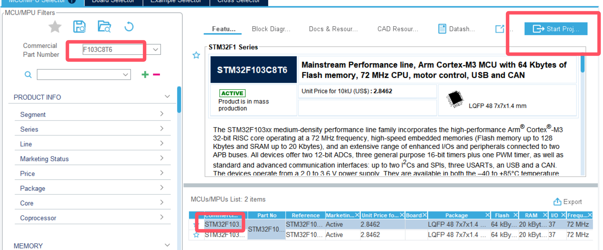
*图 1　MCU Selector 中选中 STM32F103C8T6（LQFP48）*

**RCC**：`System Core → RCC`，`High Speed Clock (HSE)` = **Crystal/Ceramic Resonator**，使用板上 8 MHz 晶振。

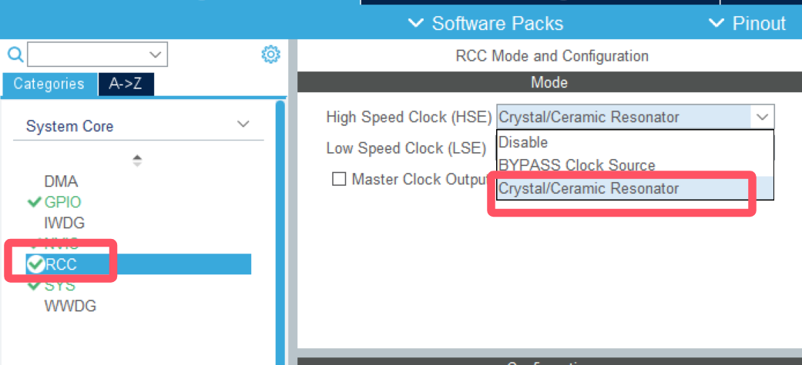
*图 2　RCC 中 HSE 选择 Crystal/Ceramic Resonator*

**SYS**：`System Core → SYS`，`Debug` = **Serial Wire**，只占 PA13/PA14 两根 SWD 线，不占用 PB3/PB4/PA15。

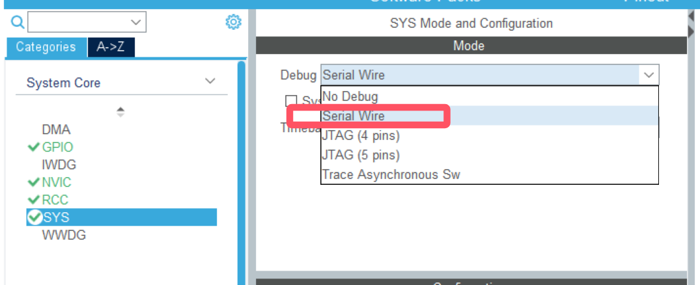
*图 3　SYS 中 Debug 选择 Serial Wire*

**时钟树**：HSE 8 MHz → `PLL Source Mux = HSE`、`PLLMul = ×9` → `System Clock Mux = PLLCLK`，SYSCLK = **72 MHz**；AHB /1 → HCLK 72 MHz，APB1 /2 → 36 MHz，APB2 /1 → 72 MHz，ADC /2 → 36 MHz。

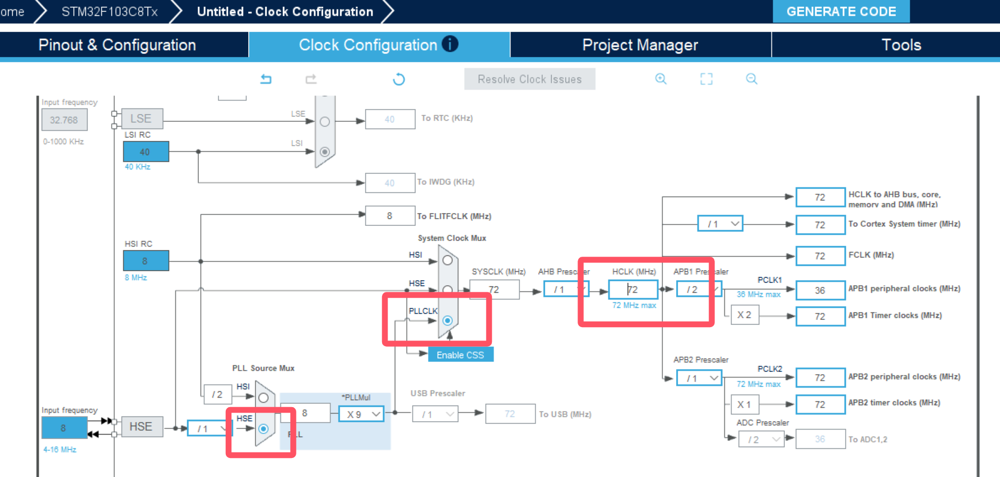
*图 4　时钟树：SYSCLK = HCLK = 72 MHz，APB1 = 36 MHz*

**GPIO**：在引脚图上把 **PB8、PB9** 设为 `GPIO_Output`，再到 `System Core → GPIO` 里统一设参数：

| 参数 | 值 | 原因 |
| --- | --- | --- |
| GPIO output level | High | I2C 空闲时两根线都应为高 |
| GPIO mode | Output Open Drain | I2C 是线与总线，只能拉低、不能推高 |
| GPIO Pull-up/Pull-down | Pull-up | 模块板载 4.7 kΩ 上拉 + 内部上拉双保险 |
| Maximum output speed | High | 位翻转要快，边沿才不拖沓 |

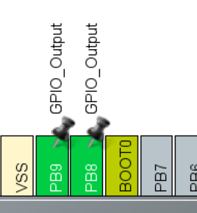
*图 5　引脚图上把 PB8、PB9 设为 GPIO_Output（软件 I2C 的 SCL/SDA）*

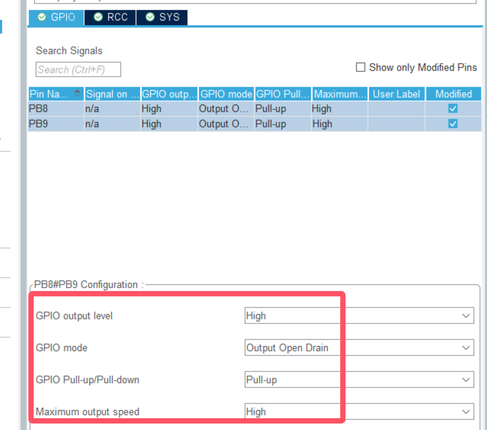
*图 6　PB8/PB9 参数：开漏输出、上拉、初始高电平、高速*

**Project Manager**：`Project Name = task1`、`Project Location = F:\Fundamentals_of_Embedded_Systems\expr3`、`Application Structure = Advanced`、`Toolchain/IDE = MDK-ARM`、`Min Version = V5.32`、`Firmware Package = STM32Cube FW_F1 V1.8.7`。

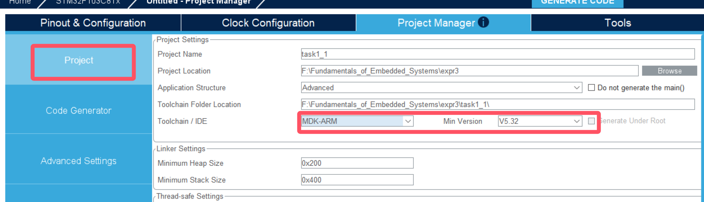
*图 7　Project Manager：MDK-ARM V5.32、FW_F1 V1.8.7（图中工程名最初写成 task1_1，后改回 task1）*

**Code Generator** 勾选四项：`Copy only the necessary library files`、`Generate peripheral initialization as a pair of '.c/.h' files per peripheral`、`Keep User Code when re-generating`、`Delete previously generated files when not re-generated`，然后 `GENERATE CODE`。

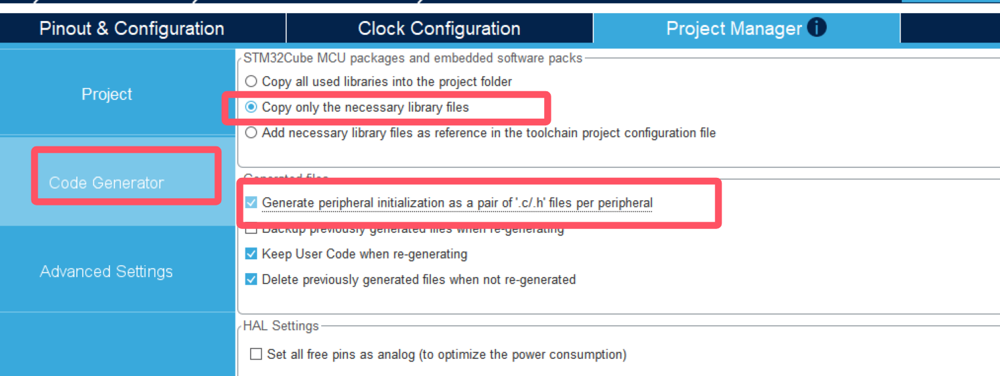
*图 8　Code Generator 的四个勾选项*

### 3.2 把标准库驱动裁剪成 HAL 版

 这里用的`OLED.c`等OLED的底层代码来自于江科大开源，是基于标准库（`stm32f10x.h`）的，移植到 HAL 工程需要做一些改动。

移植后的软件 I2C 底层：

```c
static void OLED_I2C_Delay(void)
{
    for (volatile uint8_t i = 0; i < 12; i++)
    {
        __NOP();
    }
}

static void OLED_W_SCL(uint8_t Level)
{
    HAL_GPIO_WritePin(OLED_SCL_PORT, OLED_SCL_PIN, Level ? GPIO_PIN_SET : GPIO_PIN_RESET);
    OLED_I2C_Delay();
}

static void OLED_W_SDA(uint8_t Level)
{
    HAL_GPIO_WritePin(OLED_SDA_PORT, OLED_SDA_PIN, Level ? GPIO_PIN_SET : GPIO_PIN_RESET);
    OLED_I2C_Delay();
}


static void OLED_I2C_Start(void)
{
    OLED_W_SDA(1);
    OLED_W_SCL(1);
    OLED_W_SDA(0);
    OLED_W_SCL(0);
}


static void OLED_I2C_SendByte(uint8_t Byte)
{
    uint8_t i;
    for (i = 0; i < 8; i++)
    {
        OLED_W_SDA(!!(Byte & (0x80 >> i)));
        OLED_W_SCL(1);
        OLED_W_SCL(0);
    }
    OLED_W_SCL(1);     
    OLED_W_SCL(0);
}
```

文件放在工程的 `bsp\` 目录下（`oled.c`、`oled.h`、`oled_font.h`），在 Keil 里右键 Target → `Manage Project Items` 增加 `bsp` 分组，并在 `Options for Target → C/C++ → Include Paths` 里加上 `..\bsp`。

### 3.3 用 PCtoLCD2002 取模

按 2.3 节的参数设置好「字模选项」，字体选 **宋体 16×16**，在文字框输入：

```
陈立周欢迎来到重庆交通大学物联网实训室，！
```

点「生成字模」，每个字得到 32 字节（前 16 字节上半页、后 16 字节下半页）。本次共 21 个字，正好覆盖姓名与后面滚动长句用到的全部汉字与全角标点。

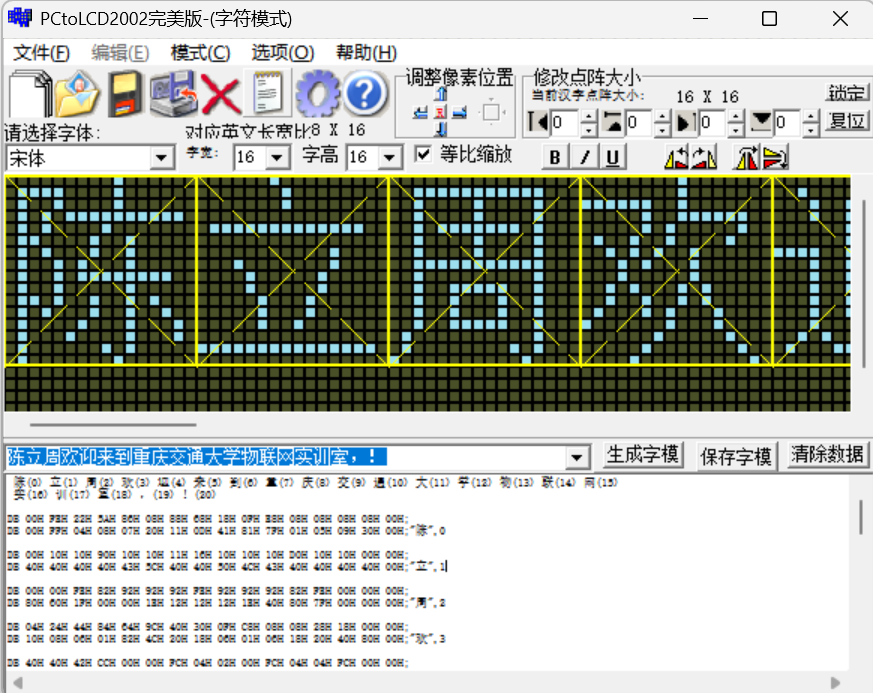
*图 9　PCtoLCD2002：宋体 16×16，上方为 21 个字的点阵预览，下方为 ASM 格式字模*

### 3.4 建字库表与显示函数

把取模结果整理成 `bsp\oled_cn_font.h`。为了让“一个汉字 + 它的字模”绑在一起，并避开 UTF-8 多字节问题，用 **Unicode 码点**做索引：

```c
typedef struct
{
    uint16_t code;          // Unicode 码点，如 0x9648 = 陈 
    uint8_t  data[32];      // 16x16：上半页 16 字节 + 下半页 16 字节 
} OLED_CN_Glyph;

#define OLED_CN_NUM    21

const OLED_CN_Glyph OLED_CN_Table[OLED_CN_NUM] =
{
    { 0x9648, { 0x00, 0xFE, 0x22, 0x5A, 0x86, 0x08, 0x88, 0x68, 0x18, 0x0F, 0xE8, 0x08, 0x08, 0x08, 0x08, 0x00,
                0x00, 0xFF, 0x04, 0x08, 0x07, 0x20, 0x11, 0x0D, 0x41, 0x81, 0x7F, 0x01, 0x05, 0x09, 0x30, 0x00 } },   /* 陈 */
   
};
```

> C 语言里 `"陈"` 是 3 个字节，按字节取字会把汉字拆坏；存成 `uint16_t` 码点数组后，显示时直接查表，既准确又省空间。

字库头文件加进 Keil 的 `bsp` 分组：

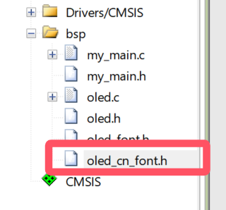
*图 10　Keil 工程树：bsp 分组下的 6 个源文件，含新加的 oled_cn_font.h*

`oled.c` 里引入两套字库（ASCII 8×16 与汉字 16×16），并在底层 `OLED_ShowChinese()` 之上增加“查表 + 连续显示”两个函数：

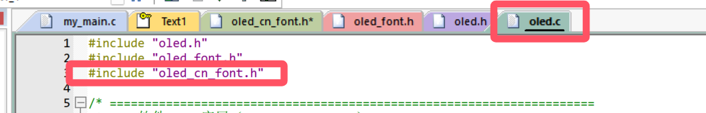
*图 11　oled.c 顶部三行 include：ASCII 字库 + 汉字字库*

```c
// 按 Unicode 码点查字模
void OLED_ShowCNChar(uint8_t Line, uint8_t Column, uint16_t Code)
{
    uint8_t i;
    for (i = 0; i < OLED_CN_NUM; i++)
    {
        if (OLED_CN_Table[i].code == Code)
        {
            OLED_ShowChinese(Line, Column, OLED_CN_Table[i].data);
            return;
        }
    }
    OLED_ShowChar(Line, Column, '?');
}

// 显示一串汉字
void OLED_ShowCNString(uint8_t Line, uint8_t Column, const uint16_t *Str)
{
    while (*Str != 0)
    {
        OLED_ShowCNChar(Line, Column, *Str);
        Column += 2;            /* 16 像素 = 2 个 8 像素列 */
        Str++;
        if (Column > OLED_COL_MAX - 1)
        {
            break;
        }
    }
}
```

其中 `OLED_ShowChinese()` 负责把一个字的 32 字节分两页写进显存：

```c
void OLED_ShowChinese(uint8_t Line, uint8_t Column, const uint8_t *Font)
{
    uint8_t i;

    OLED_SetCursor((Line - 1) * 2, (Column - 1) * 8);        // 上半页 
    for (i = 0; i < 16; i++)
    {
        OLED_WriteData(Font[i]);
    }
    OLED_SetCursor((Line - 1) * 2 + 1, (Column - 1) * 8);    // 下半页 
    for (i = 0; i < 16; i++)
    {
        OLED_WriteData(Font[i + 16]);
    }
}
```

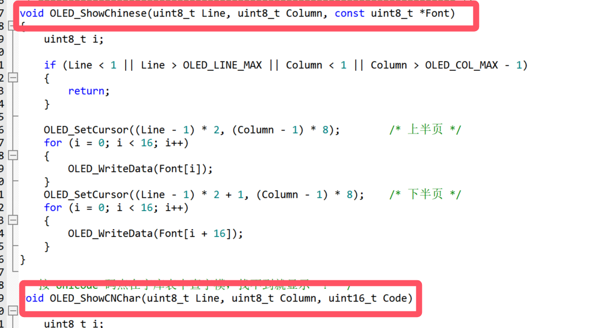
*图 12　oled.c 中的 OLED_ShowChinese() 与 OLED_ShowCNChar()*

对应在 `oled.h` 里增加三个声明：

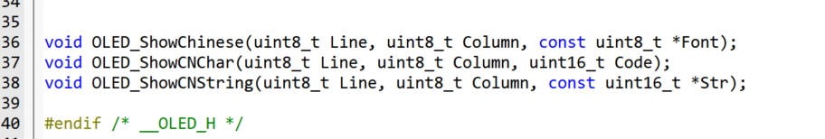
*图 13　oled.h 中新增的 OLED_ShowChinese / OLED_ShowCNChar / OLED_ShowCNString*

### 3.5 应用层与实验现象

`bsp\my_main.c` 只负责显示的内容以及位置：

```c
#include "my_main.h"

#define STUDENT_ID      "632407030121"

static const uint16_t CN_NAME[] = { 0x9648, 0x7ACB, 0x5468, 0x0000 };  //陈立周

void setup(void)
{
    OLED_Init();                            // 初始化 

    OLED_ShowString(2, 1, "ID:");
    OLED_ShowString(2, 4, STUDENT_ID);      //学号 632407030121 

    OLED_ShowString(3, 1, "Name:");        
    OLED_ShowCNString(3, 6, CN_NAME);      
}

void loop(void)
{
}
```

`main.c` 只需要在 USER CODE 区把 `setup()` 和 `loop()` 接上（这是 CubeMX 重新生成代码时不会被覆盖的区域）：

```c
/* USER CODE BEGIN Includes */
#include "my_main.h"
/* USER CODE END Includes */

  /* USER CODE BEGIN 2 */
  setup();                      
  /* USER CODE END 2 */

  while (1)
  {
    loop();                   
```


下载后屏上显示两行：

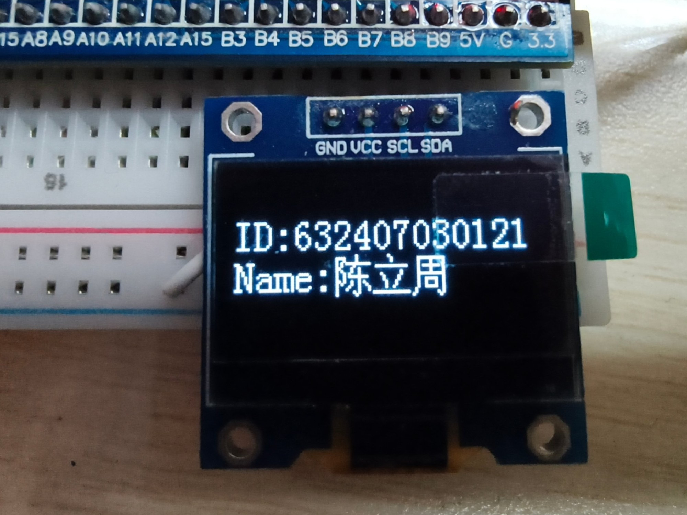
*图 14　实物：屏上清晰显示 ID:632407030121 与 Name:陈立周（8×16 ASCII + 16×16 汉字）*


## 四、任务一(3)：长字符滑动显示

任务要求“上下或左右滑动显示长字符，最好使用硬件刷屏模式”。本实验用**同一个工程先后演示两种滑动方式**：先跑 SSD1306 自带的**硬件水平滚动**，再用 CPU 做**软件滚屏**显示超过一屏的长句。

### 4.1 两种滑动方式的本质区别

| 方式 | 谁在动 | 能滚多长 | 特点 |
| --- | --- | --- | --- |
| **硬件水平滚动**（0x26/0x27 + 0x2F） | SSD1306 驱动芯片内部的地址发生器 | 只有显存里的 **128 列**，滚到头会循环接回开头 | CPU 完全不参与，一条命令就让整行自己走 |
| **软件滚屏**（取窗口 + 批量写页） | CPU，每帧重写显存内容 | 任意长（受 RAM/Flash 限制），本实验长句 **352 像素** | 要占 CPU 和 I2C 带宽，但能显示超长文本、可控制方向和速度 |


### 4.2 硬件水平滚动：让芯片自己滚

SSD1306 的水平滚动命令由 7 个字节组成，最后用 `0x2F` 启动、`0x2E` 停止：

```c
void OLED_ScrollH_Start(uint8_t StartPage, uint8_t EndPage, uint8_t Direction, uint8_t Interval)
{
    OLED_WriteCommand(Direction ? 0x26 : 0x27);
    OLED_WriteCommand(0x00);      
    OLED_WriteCommand(StartPage & 0x07);
    OLED_WriteCommand(Interval);   
    OLED_WriteCommand(EndPage & 0x07);
    OLED_WriteCommand(0x00);        
    OLED_WriteCommand(0xFF);      
    OLED_WriteCommand(0x2F);      
}

void OLED_ScrollH_Stop(void)
{
    OLED_WriteCommand(0x2E);        
}
```

先把短句 `Hello，重庆交大`（120 像素，正好放进 128 列）画到页 4~5，然后向右滚 5 s、向左滚 5 s：

```c
memcpy(buf, HwTextTop, HW_TEXT_WIDTH);     
OLED_WritePageData(4, 0, buf, 128);
memcpy(buf, HwTextBottom, HW_TEXT_WIDTH);
OLED_WritePageData(5, 0, buf, 128);

OLED_ScrollH_Start(4, 5, 1, 0x07);          
HAL_Delay(5000);
OLED_ScrollH_Stop();
OLED_ScrollH_Start(4, 5, 0, 0x07);        
HAL_Delay(5000);
OLED_ScrollH_Stop();
```

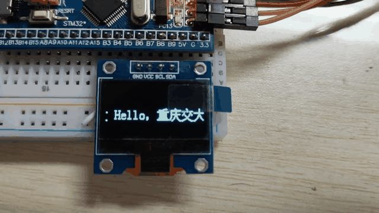

*图 15　硬件水平滚动：页 4~5 上的短句 `Hello，重庆交大` 整行循环平移，先向右后向左

### 4.3 软件滚屏：每帧搬一个窗口

**思路**：把长句 352 像素的点阵预先存成两张表（`ScrollTextTop` / `ScrollTextBottom`，各 352 字节，分别对应上半页和下半页），滚动时不必重新查字库，只要改变“窗口起点” `Offset`，把窗口里的 128 个像素列搬到页 4~5 即可。

难点是**窗口起点不一定落在字节边界上**（Offset 可能是 1、2、3…像素），这时一列像素会跨两个字节，需要按位拼接：

```c
// 从长句点阵取 128 像素宽窗口
static void OLED_DrawScrollLine(uint16_t Offset)
{
    uint8_t top[128], bottom[128];
    uint8_t s = (uint8_t)(Offset & 0x07);       
    uint16_t i, k = (uint16_t)(Offset >> 3);   

    for (i = 0; i < 128; i++)
    {
        if (s == 0)
        {
            top[i]    = ScrollTextTop[k + i];
            bottom[i] = ScrollTextBottom[k + i];
        }
        else
        
            top[i]    = (uint8_t)((ScrollTextTop[k + i] >> s) |
                                  ((uint16_t)ScrollTextTop[k + i + 1] << (8 - s)));
            bottom[i] = (uint8_t)((ScrollTextBottom[k + i] >> s) |
                                  ((uint16_t)ScrollTextBottom[k + i + 1] << (8 - s)));
        }
    }
    OLED_WritePageData(4, 0, top, 128);
    OLED_WritePageData(5, 0, bottom, 128);
}
```

**批量写页**是让滚屏流畅的关键：SSD1306 每写一个数据字节，列地址会自动 +1，所以一次 START 就能连写满一页，不必每个字节都 START/STOP（省掉 0x78、0x40 和重复的起停，实测快 3~4 倍）：

```c
void OLED_WritePageData(uint8_t Page, uint8_t X, const uint8_t *Data, uint16_t Len)
{
    OLED_WriteCommand(0xB0 | (Page & 0x07));        
    OLED_WriteCommand(0x10 | ((X & 0xF0) >> 4));    
    OLED_WriteCommand(0x00 | (X & 0x0F));           

    OLED_I2C_Start();
    OLED_I2C_SendByte(OLED_I2C_ADDR_W);
    OLED_I2C_SendByte(0x40);                      
    for (uint16_t i = 0; i < Len; i++)
    {
        OLED_I2C_SendByte(Data[i]);
    }
    OLED_I2C_Stop();
}
```

主循环里让窗口从头滚到尾、再反向滚回来：

```c
for (x = 0; x <= SCROLL_TEXT_WIDTH - 128; x += 2)  
    OLED_DrawScrollLine(x);
    HAL_Delay(15);
}
for (x = SCROLL_TEXT_WIDTH - 128; x > 0; x -= 2)   
    OLED_DrawScrollLine(x);
    HAL_Delay(15);
}
```

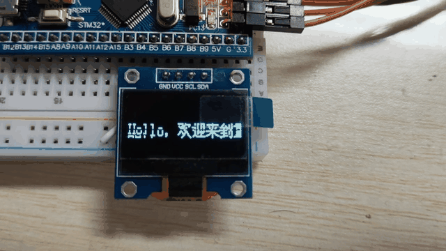

*图 16　软件滚屏：352 像素的长句自右向左滚过屏幕，滚到句尾后再反向滚回；一屏只显示 128 像素


### 4.4 对比结论

- 硬件滚动**几乎不占 CPU**，但被显存 128 列限制，只能做“一屏内循环滚动”，且方向、速度只能从芯片给的几档里选；
- 软件滚屏**耗 CPU 和 I2C 带宽**（本实验约 36 帧/秒、每帧写 256 字节），但能滑动任意长文本、可任意控制方向与速度，是显示长句、歌词、诗文的正确做法；
- 题目说“最好用硬件刷屏模式”，在 128×64 的 0.96 寸屏上只对“一屏以内的文字”成立；**长字符必须软件滚屏**，硬件滚动可以作为补充演示，两者结合才完整。


## 五、任务三：把 u8g2 移植到 STM32F103 的 HAL 工程

任务要求：用 CubeMX 设计 HAL 程序框架，下载 u8g2 源码，针对 STM32F103 + 0.96 寸 I2C OLED 裁剪移植，完成 ①demo 例程 ②显示学号姓名 ③上下/左右滑动 ④图案（头像）动态效果。

本节的移植流程参照 CSDN 博客《基于STM32移植U8g2图形库——OLED显示（HAL库）》：CubeMX 配 RCC/SYS/**I2C2**/**TIM1** → 下载源码 → 精简驱动/setup/memory → Keil 加文件 → 写 `stm32_u8g2.c/h` 移植层 → 写测试画面。

### 5.1 为什么用 u8g2

u8g2 是面向单色屏的开源图形库，分两层：**u8x8** 负责底层通信与字符输出，**u8g2** 负责图形、字体和整屏缓冲。它自带 SSD1306 等上百种显示驱动、多种字体，以及线、框、圆、椭圆、圆弧、位图等绘图 API，并支持**全屏缓冲**——先在 RAM 里画满一屏再一次性 `u8g2_SendBuffer()`，画面不会撕裂。

本工程最终占用 **Flash ≈ 35 KB、RAM ≈ 3.1 KB**，在 64 KB/20 KB 的 STM32F103C8 上还有余量。

### 5.2 博客方案的三个关键点

| 关键点 | 博客做法 | 本实验对应 |
| --- | --- | --- |
| 通信 | **硬件 I2C2**（PB10=SCL、PB11=SDA），`HAL_I2C_Master_Transmit` 发数据 | 与博客一致，OLED 两根线从 PB8/PB9 改接到 **PB10/PB11** |
| 延时 | **TIM1** 计数做微秒延时（u8g2 的“心跳”） | TIM1：PSC = 72-1 → 1 MHz，计一个数 = 1 µs |
| 移植接口 | 只写 `stm32_u8g2.c/h`：`u8x8_byte_hw_i2c()` + `u8x8_gpio_and_delay()` + `u8g2Init()` | 与博客一致，另外补了博客没给的 `Tims_delay_us()` |

### 5.3 下载与解压 u8g2 源码

从 GitHub（<https://github.com/olikraus/u8g2>）→ `Code → Download ZIP` 下载 master 分支（本机 84.2 MB）。

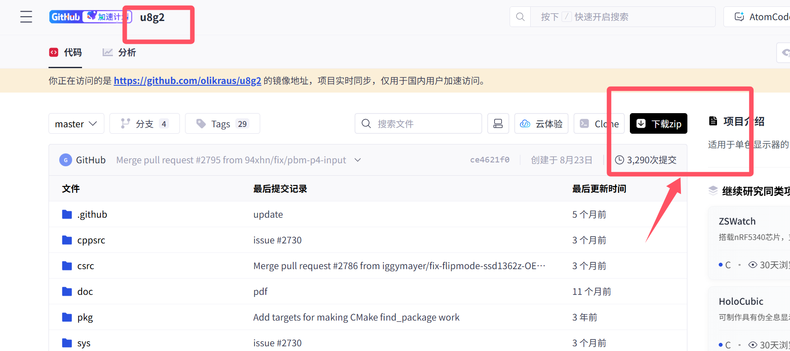
*图 17　在 GitHub 上点“下载 zip”获取 u8g2 源码*

解压后只需要 **`csrc/`** 目录（138 个文件），其中 `u8g2_fonts.c` 有 38.8 MB。

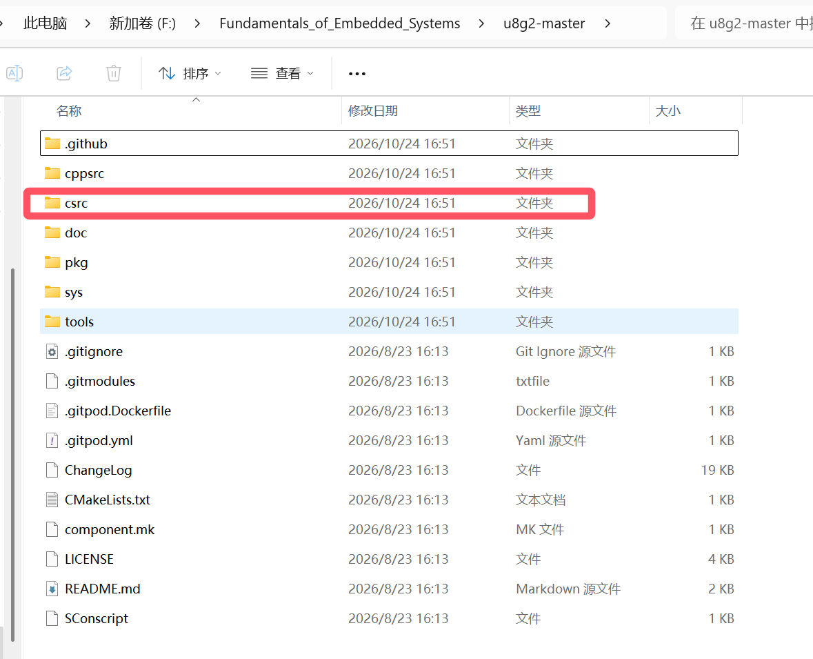
*图 18　解压后的 u8g2-master 目录，移植只关心 csrc*

### 5.4 裁剪 u8g2 库（博客 3.2 的三步）

**① 复制 csrc 到 `bsp\`**，然后删掉用不到的扩展文件：

```
mui.c  mui.h  mui_u8g2.c  mui_u8g2.h
u8log.c  u8log.h  u8log_u8g2.c  u8log_u8g2.h  u8log_u8x8.c  u8log_u8x8.h
u8x8_fonts.c
u8g2_button.c  u8g2_input_value.c  u8g2_message.c  u8g2_selection_list.c
u8x8_debounce.c  u8x8_input_value.c  u8x8_message.c  u8x8_selection_list.c
```

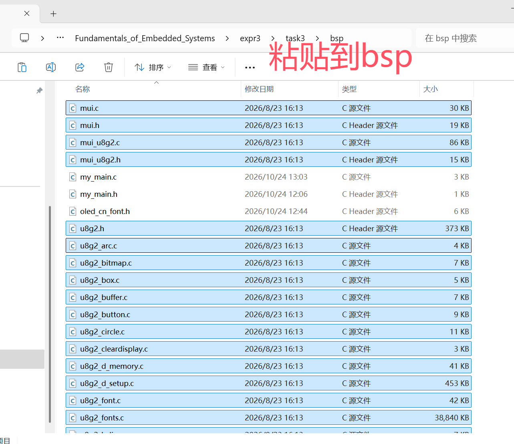
*图 19　把 csrc 的文件复制进 bsp（图中还能看到 mui/u8log/u8g2_fonts.c 等待删文件）*

**② 驱动文件只留一个**：搜索 `u8x8_d_`，除 **`u8x8_d_ssd1306_128x64_noname.c`** 外全部删除（SSD1305/SSD1309/SH1106/ST7565…共一百多个）。

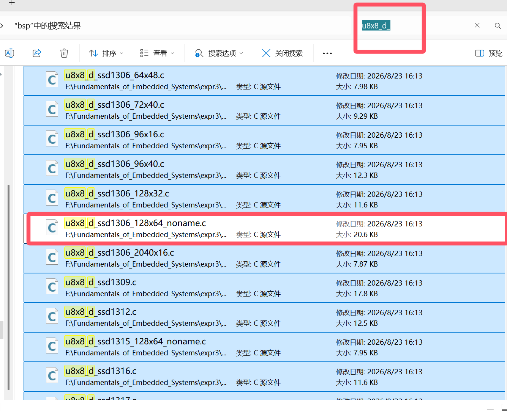
*图 20　按 `u8x8_d_` 搜索，只保留 SSD1306 128×64 的驱动*

**③ 三个大文件用脚本抽取**：`u8g2_d_setup.c`（456 KB）、`u8g2_d_memory.c`（40 KB）、`u8g2_fonts.c`（38.8 MB）。原版直接放进工程会有两个后果：前两个引用了已删除的驱动，链接时报 `undefined symbol`；字体文件远超 64 KB Flash，实测 Keil 链接器**不会**自动丢弃未使用的 const 数组。所以先删掉原版，再由脚本从官方源码里“整段复制”出所需部分。

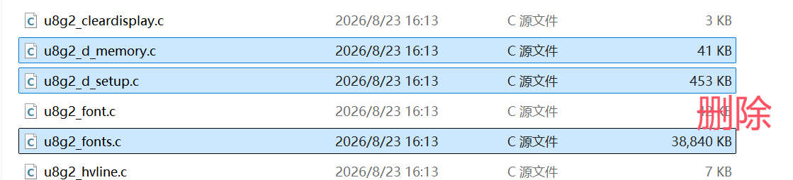
*图 21　先删掉三个官方大文件（后面由脚本生成精简版）*

### 5.4.1 裁剪后的文件清单

裁剪完成后 `bsp\` 共 **37 个文件**：

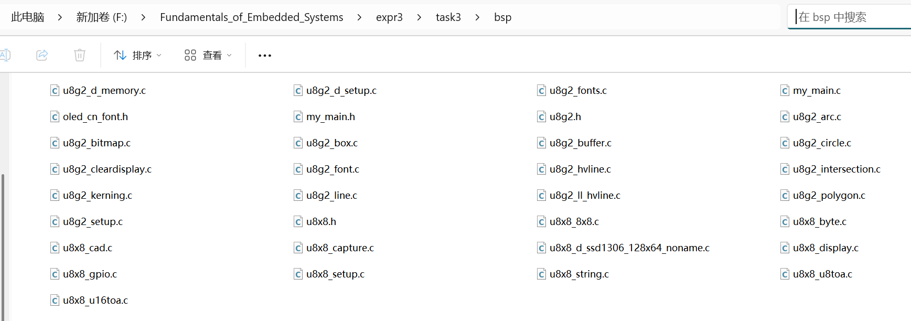
*图 22　裁剪后的 bsp（33 个文件；随后又加入 test.c/h、stm32_u8g2.c/h 共 37 个）*

### 5.4.2 裁剪脚本（从官方源码抽取，代码原样保留）

脚本对官方 `csrc` 只做“按名字找到并整段复制”，脚本放在工程外的 `tmp\trim_u8g2.py`，运行：

```powershell
cd F:\Fundamentals_of_Embedded_Systems\tmp
python trim_u8g2.py
```

```python
# -*- coding: utf-8 -*-
r"""
从官方 u8g2 源码里抽取“精简版”文件（只挑需要的函数/字体），
其余内容原样保留、不做任何改写，保证代码仍然 100% 来自官方 csrc。

用法（在 PowerShell 或 cmd 里运行）：
    python trim_u8g2.py

默认路径：
    官方源码：F:\Fundamentals_of_Embedded_Systems\u8g2-master\csrc
    输出目录：F:\Fundamentals_of_Embedded_Systems\expr3\task3\bsp

输出 3 个文件：
    u8g2_d_setup.c    只保留 u8g2_Setup_ssd1306_i2c_128x64_noname_f()
    u8g2_d_memory.c   只保留 u8g2_m_16_8_f()
    u8g2_fonts.c      只保留下面 FONTS 里列出的字体
"""
import os
import re

SRC = r'F:\Fundamentals_of_Embedded_Systems\u8g2-master\csrc'
OUT = r'F:\Fundamentals_of_Embedded_Systems\expr3\task3\bsp'

# 本工程用到的字体（博客 demo + 我们的界面）
FONTS = [
    'u8g2_font_inb24_mf',
    'u8g2_font_inb30_mn',
    'u8g2_font_4x6_tr',
    'u8g2_font_ncenB12_tf',
    'u8g2_font_ncenB08_tf',
    'u8g2_font_6x12_tf',
    'u8g2_font_helvB10_tf',
]


def read_lines(path):
    with open(path, encoding='utf-8', errors='ignore') as f:
        return f.read().splitlines()


def extract_func(src_file, marker, out_name):
    lines = read_lines(os.path.join(SRC, src_file))
    start = None
    for i, line in enumerate(lines):
        if re.search(marker, line):
            start = i
            break
    if start is None:
        raise SystemExit('没找到函数：%s' % marker)
    end = start
    while end < len(lines) and not lines[end].rstrip().endswith('}'):
        end += 1
    body = '\n'.join(lines[start:end + 1])
    text = '#include "u8g2.h"\n\n' + body + '\n'
    dst = os.path.join(OUT, out_name)
    with open(dst, 'w', encoding='utf-8', newline='\n') as f:
        f.write(text)
    print('  %-20s 抽取函数 %s（第 %d~%d 行，%.1f KB）'
          % (out_name, marker.strip('\\'), start + 1, end + 1, len(text) / 1024))


def extract_fonts():
    lines = read_lines(os.path.join(SRC, 'u8g2_fonts.c'))
    out = ['#include "u8g2.h"', '']
    for name in FONTS:
        start = None
        for i, line in enumerate(lines):
            if line.startswith('const uint8_t ' + name + '['):
                start = i
                break
        if start is None:
            raise SystemExit('没找到字体：%s' % name)
        end = start
        while end < len(lines) and not lines[end].rstrip().endswith('";'):
            end += 1
        out.extend(lines[start:end + 1])
        out.append('')
        print('  字体 %-24s 第 %d~%d 行' % (name, start + 1, end + 1))
    text = '\n'.join(out) + '\n'
    dst = os.path.join(OUT, 'u8g2_fonts.c')
    with open(dst, 'w', encoding='utf-8', newline='\n') as f:
        f.write(text)
    print('  u8g2_fonts.c 生成完成：%.1f KB（官方原版 38.8 MB）' % (len(text) / 1024))


if __name__ == '__main__':
    print('官方源码：', SRC)
    print('输出目录：', OUT)
    if not os.path.isdir(OUT):
        raise SystemExit('输出目录不存在，先建好 expr3\\task3\\bsp')
    print('1. 抽取 u8g2_d_setup.c ...')
    extract_func('u8g2_d_setup.c',
                 r'void u8g2_Setup_ssd1306_i2c_128x64_noname_f\(',
                 'u8g2_d_setup.c')
    print('2. 抽取 u8g2_d_memory.c ...')
    extract_func('u8g2_d_memory.c',
                 r'uint8_t \*u8g2_m_16_8_f\(uint8_t \*page_cnt\)',
                 'u8g2_d_memory.c')
    print('3. 抽取 u8g2_fonts.c ...')
    extract_fonts()
    print('完成，3 个文件已写入：', OUT)
```

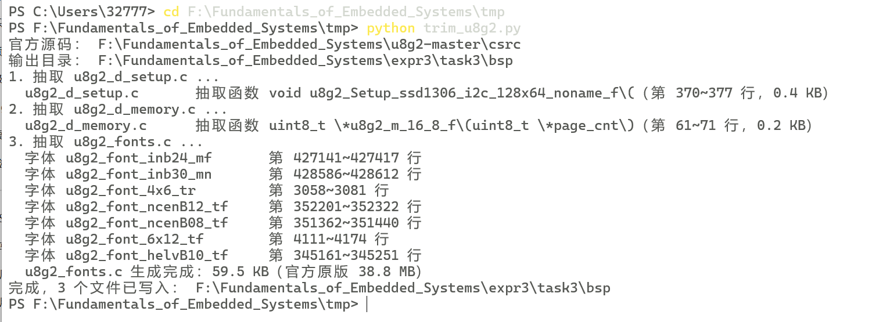
*图 23　裁剪脚本运行结果：三个大文件被抽取成 0.4 KB / 0.2 KB / 59.5 KB*

### 5.5 CubeMX 配置（博客第二节）

在任务一工程基础上（72 MHz、SWD 不变）增加两个外设：

| 外设 | 参数 | 说明 |
| --- | --- | --- |
| **I2C2** | `I2C` 模式，Fast Mode，Clock Speed **400000** | 引脚 **PB10 = I2C2_SCL、PB11 = I2C2_SDA** |
| **TIM1** | Clock Source = Internal Clock，`Prescaler = 72-1`，`Counter Period = 65535` | 72 MHz ÷ 72 = **1 MHz**，计一个数 = 1 µs |

原来 PB8/PB9 的软件 I2C 配置点 `Reset_State` 去掉，OLED 两根信号线改接到 **PB10/PB11**。

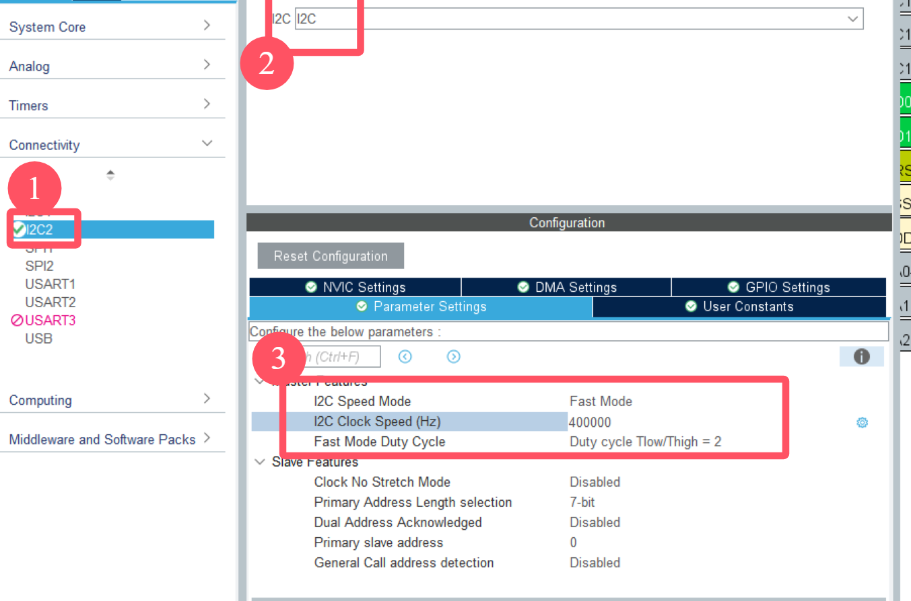

*图 24　I2C2：Fast Mode、400 kHz*

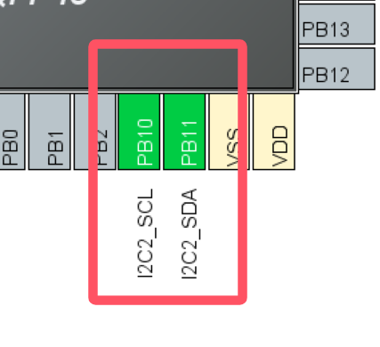

*图 25　PB10、PB11 被配置成 I2C2_SCL / I2C2_SDA*

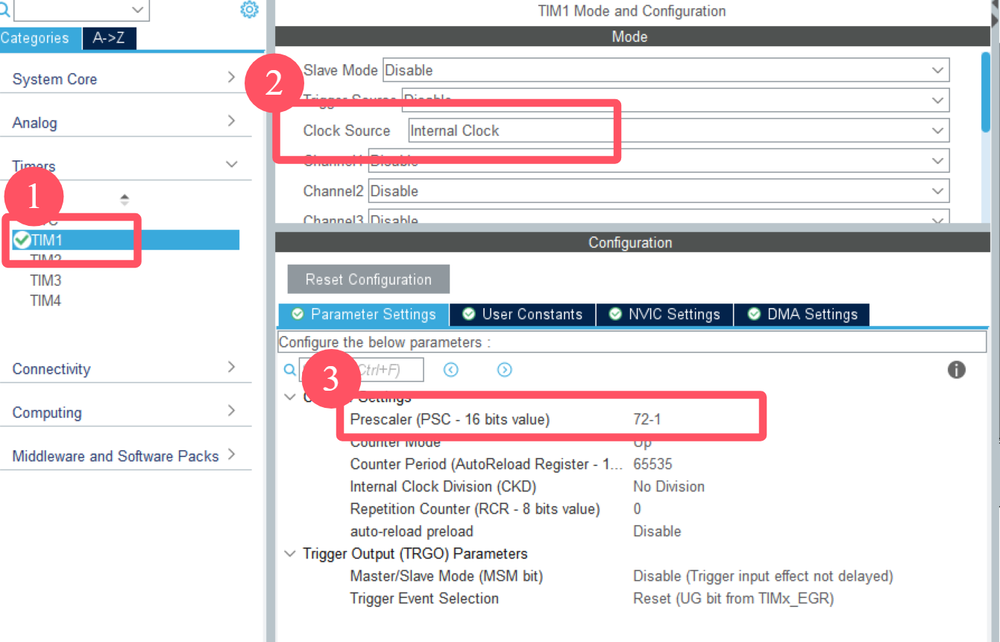

*图 26　TIM1：PSC = 72-1，ARR = 65535，得到 1 MHz 计数*

生成代码后 `Core/Src` 会多出 `i2c.c`、`tim.c`，`main.c` 里自动调用 `MX_I2C2_Init()`、`MX_TIM1_Init()`。

### 5.6 Keil 工程配置（博客 3.3）

1. `Manage Project Items` 新建分组 **`u8g2`**，把 `bsp\` 下 30 个 u8g2 的 `.c/.h` 加进去；
2. `bsp` 分组加入 `my_main.c/h`、`stm32_u8g2.c/h`、`test.c/h`、`oled_cn_font.h`；
3. `Options for Target → C/C++ → Include Paths` 增加 **`..\bsp`**（u8g2 文件直接放在 bsp 下，不再建子目录）。

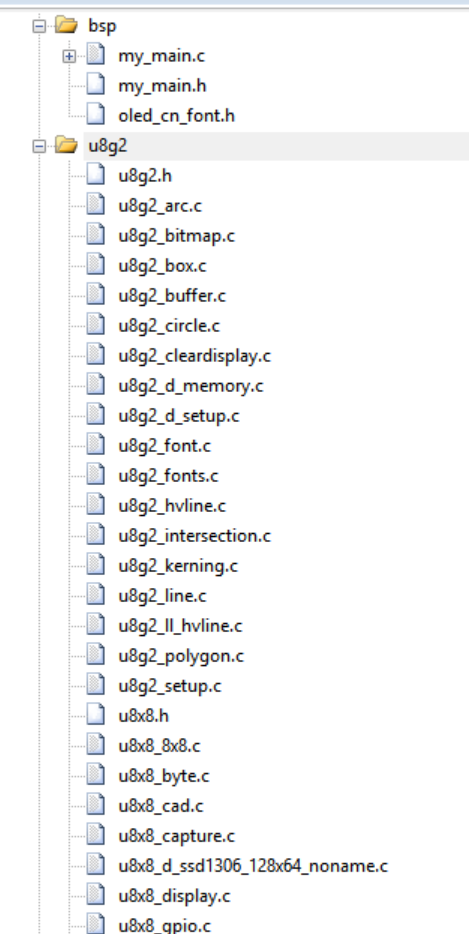
*图 27　Keil 工程树：bsp 分组（应用层/移植层）与 u8g2 分组（库文件）*

### 5.7 移植层：`stm32_u8g2.c/h`（博客 4.1）

移植的本质只有两个函数要写：**通信**和**延时**。

**① 通信层 `u8x8_byte_hw_i2c()`**：u8g2 在 START_TRANSFER 与 END_TRANSFER 之间给的字节不超过 128 个，先攒进静态缓冲区，最后一次性 `HAL_I2C_Master_Transmit` 发出去。

```c
uint8_t u8x8_byte_hw_i2c(u8x8_t *u8x8, uint8_t msg, uint8_t arg_int, void *arg_ptr)
{
    static uint8_t buffer[128];
    static uint8_t buf_idx;
    uint8_t *data;

    switch (msg)
    {
    case U8X8_MSG_BYTE_INIT:
        break;                                 
    case U8X8_MSG_BYTE_START_TRANSFER:
        buf_idx = 0;
        break;
    case U8X8_MSG_BYTE_SEND:
        data = (uint8_t *)arg_ptr;
        while (arg_int > 0) { buffer[buf_idx++] = *data; data++; arg_int--; }
        break;
    case U8X8_MSG_BYTE_END_TRANSFER:
        if (HAL_I2C_Master_Transmit(&hi2c2, OLED_ADDRESS, buffer, buf_idx, 1000) != HAL_OK)
            return 0;
        break;
    default:
        return 0;
    }
    return 1;
}
```

**② 延时层**：博客代码里调用了 `Tims_delay_us()` 但没给实现，这里用 TIM1 计数器补上：

```c
void Tims_delay_us(uint16_t us)
{
    __HAL_TIM_SET_COUNTER(&htim1, 0);
    while (__HAL_TIM_GET_COUNTER(&htim1) < us)
    {
    }
}
```

**③ 初始化**：把“SSD1306 128×64 + 硬件 I2C + 1024 字节全屏缓冲”三者绑定：

```c
void u8g2Init(u8g2_t *u8g2)
{
    u8g2_Setup_ssd1306_i2c_128x64_noname_f(u8g2, U8G2_R0,u8x8_byte_hw_i2c, u8x8_gpio_and_delay); 
    u8g2_InitDisplay(u8g2);
    u8g2_SetPowerSave(u8g2, 0);
    u8g2_ClearBuffer(u8g2);
}
```

> **踩坑：TIM1 必须手动启动**。CubeMX 只生成 `HAL_TIM_Base_Init()`，计数器并不会自己跑；而 `Tims_delay_us()` 是死等计数器递增的。忘了启动就会在 `u8g2_InitDisplay()` 里卡死、屏幕永远不亮。因此在 `setup()` 里补了一句 `HAL_TIM_Base_Start(&htim1);`。

### 5.8 应用层与四个功能（博客 4.2 + 任务要求）

`my_main.c` 只有三件事：定义全局 `u8g2_t u8g2;`、`setup()` 里启动 TIM1 并 `u8g2Init()`、`loop()` 里 `u8g2DrawTest()` 循环播放所有画面。

**（1）demo 例程（博客原版）**：用 `u8g2_font_inb24_mf`、`u8g2_font_inb30_mn`、`u8g2_font_4x6_tr` 拼出 U8g2 logo，再用进度条、三种字号、矩形、圆角矩形、圆、实心椭圆把常用绘图 API 过一遍：

```c
u8g2_SetFont(u8g2, u8g2_font_inb24_mf);
u8g2_DrawStr(u8g2, 0, 20, "U");
u8g2_SetFontDirection(u8g2, 1);
u8g2_DrawStr(u8g2, 21, 8, "8");
u8g2_SetFontDirection(u8g2, 0);
u8g2_DrawStr(u8g2, 51, 30, "g");
u8g2_DrawStr(u8g2, 67, 30, "\xb2");        /* 上标 2 */
u8g2_DrawHLine(u8g2, 2, 35, 47);
u8g2_DrawVLine(u8g2, 45, 32, 12);
```

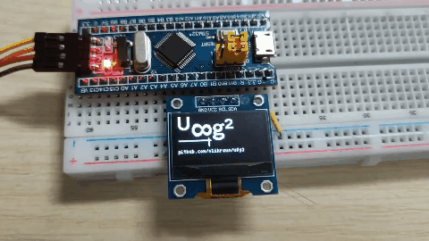

*图 28　u8g2 demo：U8g2 logo*

**（2）显示学号与姓名**：学号是 ASCII，直接用 u8g2 字体；姓名「陈立周」是汉字，u8g2 自带 CJK 字体体积远超 64 KB Flash，所以**复用任务一的 16×16 取模字模**：把 `oled_cn_font.h` 里的页式字模逐点还原成像素（`draw_cn16()`），再用 `u8g2_DrawPixel` 画进缓冲区。

```c
u8g2_SetFont(u8g2, u8g2_font_ncenB12_tf);
u8g2_DrawStr(u8g2, 2, 24, "ID:");
u8g2_DrawStr(u8g2, 30, 24, "632407030121");
draw_cn16(u8g2, 42, 38, 0x9648);   /* 陈 */
draw_cn16(u8g2, 60, 38, 0x7ACB);   /* 立 */
draw_cn16(u8g2, 78, 38, 0x5468);   /* 周 */
```

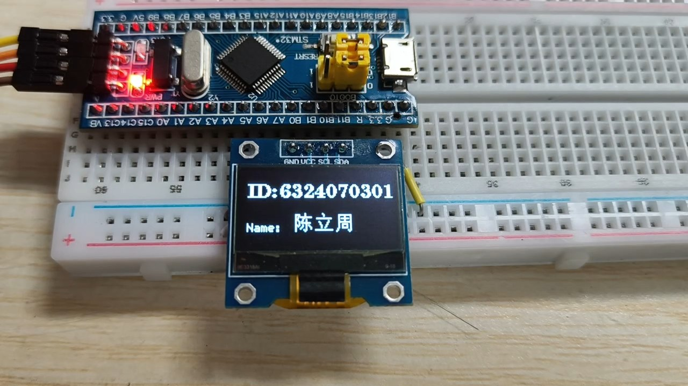
*图 29　u8g2 显示学号 `632407030121` 与姓名「陈立周」*

**（3）上下、左右滑动（中文长句）**：长句 `Hello，欢迎来到重庆交通大学物联网205实训室！` 由 ASCII 与汉字混排，因此写了两个小工具：`mixed_width()` 计算整串像素宽度（ASCII 8 像素、汉字 16 像素），`draw_mixed()` 按宽度逐字绘制。左右滑动时整串 x 坐标逐帧左移；上下滑动时三行文字 y 坐标逐帧上移。

```c
// 左右滑动 
int total = mixed_width(CN_LONG_MSG);
for (int x = 0; x < total + 128; x += 3)
{
    u8g2_ClearBuffer(u8g2);
    draw_mixed(u8g2, 128 - x, 30, CN_LONG_MSG);
    u8g2_SendBuffer(u8g2);
    HAL_Delay(20);
}

// 上下滑动（三行：STM32F103C8T6 / 重庆交通大学 / 物联网205实训室）=
for (int off = 0; off <= 3 * 18; off += 2)
{
    u8g2_ClearBuffer(u8g2);
    for (int i = 0; i < 3; i++)
    {
        int y = 14 + i * 18 - off;
        if (y > -16 && y < 64) draw_mixed(u8g2, 4, y, lines[i]);
    }
    u8g2_SendBuffer(u8g2);
    HAL_Delay(25);
}
```

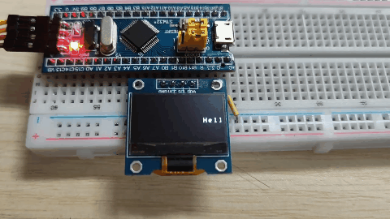

*图 30　左右滑动：中文长句自右向左滚过屏幕（动图）*

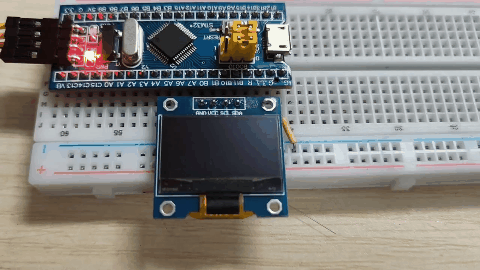

*图 31　上下滑动：三行中英混排文字向上滚（动图）*

**（4）图案（头像）与动态效果**：头像不用图片，直接用 u8g2 的圆、圆盘、直线拼出一个 40×40 的卡通脸（脸、头发弧、眼睛、鼻子、嘴巴）；动画由三部分组成——整体上下浮动、每 55 帧眨一次眼（把圆眼睛换成两条横线）、两侧星星两帧闪烁。

```c
static void draw_avatar(u8g2_t *u8g2, u8g2_uint_t cx, u8g2_uint_t cy, uint8_t blink)
{
    u8g2_DrawCircle(u8g2, cx, cy, 20, U8G2_DRAW_ALL);                 // 脸 
    u8g2_DrawCircle(u8g2, cx, cy - 22, 12,
                    U8G2_DRAW_UPPER_LEFT | U8G2_DRAW_UPPER_RIGHT);    // 头发 
    if (blink) { u8g2_DrawHLine(u8g2, cx - 11, cy - 5, 6);
                 u8g2_DrawHLine(u8g2, cx + 5,  cy - 5, 6); }
    else       { u8g2_DrawDisc(u8g2, cx - 8, cy - 5, 3, U8G2_DRAW_ALL);
                 u8g2_DrawDisc(u8g2, cx + 8, cy - 5, 3, U8G2_DRAW_ALL); }
    u8g2_DrawDisc(u8g2, cx, cy + 2, 1, U8G2_DRAW_ALL);                // 鼻子 
    u8g2_DrawCircle(u8g2, cx, cy + 6, 7,
                    U8G2_DRAW_LOWER_LEFT | U8G2_DRAW_LOWER_RIGHT);    // 嘴 
}
```

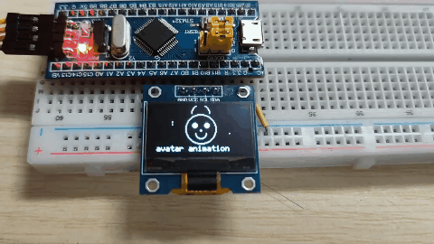
*图 32　头像图案与动态效果：上下浮动 + 眨眼 + 星星闪烁（动图）*

### 5.9 资源占用与结论

| 项目 | 数值 | 说明 |
| --- | --- | --- |
| Code + RO-data | 14956 + 20228 ≈ **35 KB** | 库 + 7 个字体 + 汉字字模 + 测试代码 |
| RW + ZI | 24 + 3088 ≈ **3.1 KB** | 其中 1 KB 是 u8g2 全屏显存 |
| 编译结果 | **0 Error**，1 个“文件末尾无换行”警告 | 官方源码自带，不影响 |
| 一轮画面 | 约 30 s | logo → 进度条 → 字体 → 矩形/圆/椭圆 → 学号姓名 → 左右滑动 → 上下滑动 → 头像 |

结论：把 u8g2 移植到 HAL 工程，本质只有两步——**① 实现 `u8x8_byte_hw_i2c()` 与 `u8x8_gpio_and_delay()` 两个回调，把通信和延时接到 HAL；② 用 `u8g2_Setup_ssd1306_i2c_128x64_noname_f()` 绑定“驱动 + 通信方式 + 缓冲模式”**。剩下的工作都是资源约束下的裁剪：删驱动、精简 setup/memory、只保留用到的字体；中文显示则复用取模字模，避免引入上百 KB 的 CJK 字库。

## 六、问题与解决

**1. 屏幕全黑：程序根本没初始化 OLED**

任务一第一次下载后屏一直不亮。检查发现 Keil 工程里已经加了 `bsp` 分组、`oled.c` 也编译进去了，但 `main.c` 的 `USER CODE BEGIN 2` 区域是空的——**没有任何地方调用 `setup()`**，MCU 只做了 `HAL_Init()`、时钟和 GPIO 初始化就进入 `while(1)` 空转，OLED 从未被初始化。解决：在 `main.c` 的 USER CODE 区补上 `#include "my_main.h"`、`USER CODE BEGIN 2` 里的 `setup()` 和 `while(1)` 里的 `loop()`。

**2. 引脚选错：本应 PB8/PB9，实际配成 PA8/PA9**

按说明配置软件 I2C 的 SCL/SDA 时，把 **PB8/PB9** 点成了 **PA8/PA9**（PB 与 PA 看混）。参数（开漏、上拉、高速）都对，编译下载也不报错，但接线、注释全对不上；而 PA9/PA10 还是 USART1 的 TX/RX，后面串口实验容易冲突。解决：引脚图上点 PA8/PA9 → `Reset_State` 解除，再点 PB8/PB9 选 `GPIO_Output`，重新设开漏 + 上拉 + 高速。

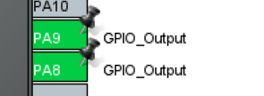
*图 33　踩坑：引脚图上 PA8/PA9 被误设为 GPIO_Output*

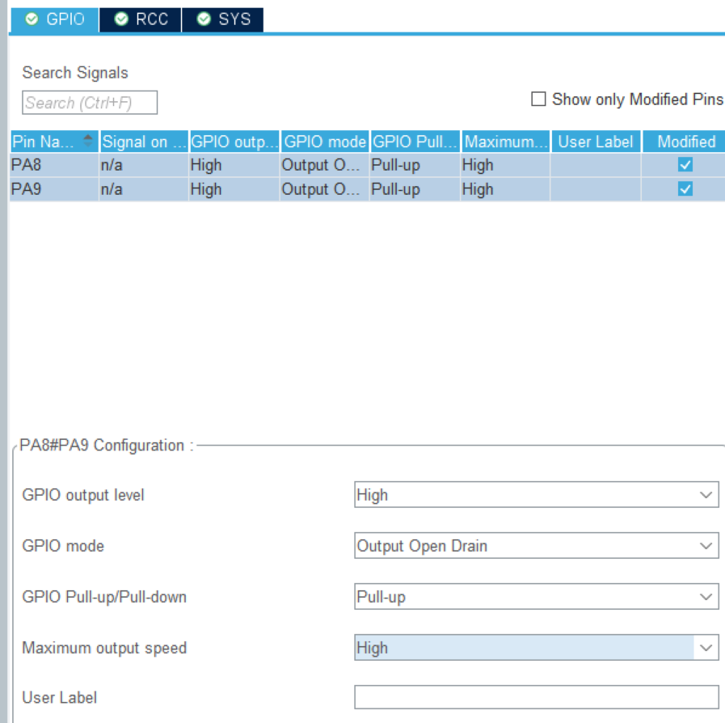
*图 34　踩坑：参数正确但引脚是 PA8/PA9（User Label 为空也能看出还没命名）*

**3. 软件 I2C 一开始没有位延时**

`HAL_GPIO_WritePin` 调用本身只要几十个时钟周期，如果位与位之间不留间隔，SCL 会跑到 1 MHz 以上，再加上开漏 + 上拉上升沿较慢，SSD1306 可能认不出数据（全黑或花屏）。解决：每次电平变化后插约 1 µs 延时，把 SCL 压到约 200 kHz（低于 SSD1306 的 400 kHz 上限）。

**4. CubeMX 里配了 I2C2/TIM1 却没生成代码**

任务三第一次检查工程时发现：`Core/Src` 里没有 `i2c.c/tim.c`，`.ioc` 里也搜不到 I2C2/TIM1。原因是只在 CubeMX 界面上配了外设，**没有保存 `.ioc`、也没点 `GENERATE CODE`**。现象是编译时报 `hi2c2`、`htim1` 未定义。解决：重新打开 `.ioc` 确认配置 → 改工程名 → `Ctrl+S` 保存 → `GENERATE CODE`。

**5. TIM1 没启动，u8g2 卡死在初始化**

CubeMX 生成的 `tim.c` 只有 `HAL_TIM_Base_Init()`，计数器并不会开始计数；而博客的 `Tims_delay_us()` 是“清计数器 → 死等计数器达到目标值”的实现。不启动 TIM1 时这个循环永远出不来，程序卡在 `u8g2_InitDisplay()` 里，屏幕全黑且没有反应。解决：在 `setup()` 里 `u8g2Init()` 之前加 `HAL_TIM_Base_Start(&htim1);`。

## 七、实验体会

这次实验让我最直观地体会到一块屏幕居然有三种驱动层次：任务一是自己写软件 I2C 一位一位地敲、自己算显存窗口；任务一(3) 在裸驱上做硬件滚动和软件滚屏，明白了“芯片内部滚动”和“CPU 搬窗口”的差别；任务三换成 u8g2 后，画线、画圆、写字都变成一行 API，代价是要先花时间把 38.8 MB 的官方库裁剪成 60 KB 的可用子集。

第二点体会是**“能编译”和“能显示”是两件事**。任务三第一次检查时 `bsp` 目录里文件都齐了，但 CubeMX 里配的 I2C2/TIM1 根本没生成代码；后来生成的代码能编译了，又因为 TIM1 没启动卡在初始化里。这两个坑都不是“代码写错”，而是“配置链条上少了一步”，也让我养成了一个习惯：**先核对生成的 .c/.h 里有没有对应外设，再看程序逻辑**。

第三点是**资源要算着花**。64 KB Flash 听起来不少，但 u8g2 库 + 7 个字体就占了 35 KB，中文字库更是不可能整包放进来；最后靠“取模字模 + 逐点还原”解决了姓名和中文长句的显示，既复用了任务一的成果，又把 Flash 控制住了。做嵌入式，能用小资源解决大需求，比堆库更有意思。

---

> 博客版（CSDN）：<https://blog.csdn.net/2401_89763261/article/details/168976415>
